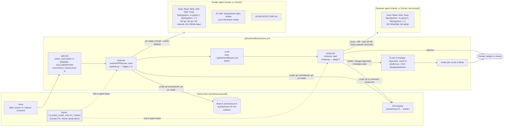

# Component view

Status: **draft** (design before build). Updated if runs change the design; see ADRs.

All automation lives in the fork `harshithseera/tinydb` (default branch `master`, pinned base `edff96a`).
This repo's `workflow/` holds a copy of `.github/workflows/` and all agent code and prompts.

## Components

| Component | Responsibility | Tools / permissions | Talks to |
|---|---|---|---|
| `gate` job | Decide whether to run: event is `issues.labeled` with `autose`, or `issue_comment` starting `/autose`; author is OWNER/COLLABORATOR | none (`permissions: {}`) | outputs issue number to `build` |
| `build` job → `pipeline.py` | Deterministic driver for stages 1–5: calls the builder agent once per stage, runs each stage's check in code, retries implement↔test, commits artifacts, opens PR | `GITHUB_TOKEN` contents/pull-requests/issues: write — used **only by the script**, never exposed to the agent | builder agent, git, `gh` |
| Builder agent | Writes spec, design, code, tests | `claude -p --allowedTools …`, working dir = checkout, `--max-turns 30` | files in the checkout only |
| `ci` job | Stage 5 check: full pytest on the PR head | `contents: read` | — |
| `review` job → `review.py` | Stage 6: fresh checkout of PR head, deletes `.autose/`, gives reviewer issue + diff, parses verdict, posts `review.md` | `contents: read`, `pull-requests: write` (script only) | reviewer agent, `gh` |
| Reviewer agent | Independent review; must run tests and cite evidence | read + run only, `--max-turns 25` | files in checkout only |
| `fix` job | One fix round: re-enters pipeline at design (approach issue) or implementation (code issue) with `review.md` | same as `build` | builder agent |

## Platform constraints that shaped this

1. **PRs opened with `GITHUB_TOKEN` do not trigger other workflows**, so a normal `on: pull_request` CI would never run on agent PRs. CI is therefore also a reusable workflow (`workflow_call`) invoked as the `ci` job.
2. **Actions cannot create PRs unless enabled**: Settings → Actions → General → "Allow GitHub Actions to create and approve pull requests". Even then, the bot cannot approve a PR it authored, so reviews are posted as comments with a `VERDICT:` line (ADR-008).
3. **Comments posted with `GITHUB_TOKEN` do not re-trigger the workflow**, so the review loop cannot be "reviewer posts /autose". The loop is unrolled as static jobs with `if:` conditions (build → review₁ → fix₁ → review₂).
4. **Artifacts on the branch would leak implementer reasoning to the reviewer**, because the reviewer checks out the PR head. `review.py` deletes `.autose/` before starting the agent.
5. **The A1 skill is interactive** (asks the stakeholder). In CI there is no stakeholder, so it runs in a mode that records open questions in `spec.md`; a vague issue whose open questions block testable criteria fails the stage-1 check and stops the run.
